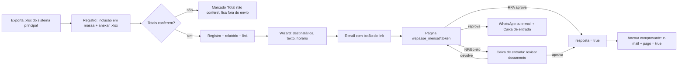

# Repasse mensal — relatório com link, aprovação e comprovante

Especificação do fluxo de repasse mensal dentro do módulo **Pagamentos** do EmerLAB.
Protótipo navegável: https://claude.ai/artifact/3aAFMXurCagGhdtgnHT6q7

> Status: **planejamento**. Nada deste documento está implementado.

---

## 1. Objetivo

Hoje o financeiro:

1. exporta o relatório de atendimentos do sistema principal (.xlsx, uma aba por prestador);
2. roda duas macros (`RearAbasPorA1` e `GerarResumoAbas`);
3. cola o resumo na **Inclusão em massa** de `Pagamentos › Registro`;
4. manda a aba de cada prestador por WhatsApp/e-mail, recebe NF/boleto pelo WhatsApp e envia o comprovante do PIX também pelo WhatsApp.

Com o novo fluxo, o EmerLAB passa a:

- ler o .xlsx, separar e nomear as abas com as mesmas regras das macros, gerar o resumo e **conferir os totais**;
- criar para cada registro um **link único** (`emerlab.com.br/repasse_mensal/<token>`) com o relatório do prestador em página web;
- enviar os links por **e-mail em massa**, agora ou distribuídos num período;
- receber do prestador a **aprovação** (RPA), a **nota fiscal** ou o **boleto**, ou a **reprovação** com observações;
- enviar o **comprovante de pagamento** por e-mail com um clique.

---

## 2. Regras de transição (obrigatórias)

### 2.1 Meses anteriores ficam como estão

- Registros de `pagamentos_registros` com competência **anterior à competência inicial do novo modelo** são **legado**: aparecem na tela exatamente como hoje, sem link, sem status de relatório e sem comprovante.
- A competência inicial é uma configuração (`repasse_config.competencia_inicial`, formato `AAAA-MM`). Padrão: **o mês em que a funcionalidade entrar no ar**.
  - Para lançar já com o relatório de **outubro/2026**, que é processado em novembro, basta configurar `2026-10`. *(decisão pendente, ver §15)*
- Nas linhas legado, as colunas novas mostram `—` e os botões novos não aparecem.

### 2.2 Dados existentes não são editados

- **Nenhuma migração faz `UPDATE` ou `DELETE` em `pagamentos_registros`.** Não há backfill.
- **Nenhuma coluna é adicionada a `pagamentos_registros`.** Tudo o que é novo fica em tabelas próprias ligadas por `registro_id` (§7).
- Os campos `valor`, `prestador_id`, `prestador_nome`, `tipo_repasse`, `chave_pix`, `obs`, `mes` e `ano` **nunca são alterados** pelo novo fluxo, nem quando o total do relatório diverge do valor do registro. Nesse caso o sistema só **avisa** (§5.4).
- O novo fluxo só liga duas flags, e só em registros do novo modelo, nos mesmos casos em que o financeiro já marca à mão hoje:
  - `resposta = true`: quando um prestador RPA aprova, ou quando o financeiro aprova uma NF/boleto na Caixa de entrada;
  - `pago = true`: quando o financeiro envia o comprovante.
  
  Nos registros com relatório vinculado, `pago` só é marcado pelo envio do comprovante (um mês ou vários do mesmo prestador). O checkbox manual continua em registros legado e sem relatório. O único caminho que desmarca `pago` é «Desfazer pagamento», que exige motivo e fica no log (`pagamento_desfeito`).

### 2.3 Registros atuais se adaptam ao novo modelo

- Registros da competência atual que **já existem** (criados antes do deploy ou à mão com "+ Linha") ganham o botão **"Vincular relatório"**. Ele cria o relatório e o link nas tabelas novas, sem mexer no registro.
- Registros criados pela Inclusão em massa com o .xlsx anexado já nascem vinculados.

---

## 3. Fluxo geral

Status do relatório: `nao_enviado` → `agendado` → `enviado` → `visualizado` → (`aprovado` | `documento_em_revisao` → `aprovado` / `documento_devolvido` | `reprovado` → `tratado`).

---

## 4. Telas (adaptadas ao EmerLAB atual)

### 4.1 `Pagamentos › Registro` (`src/pages/Pagamentos/PagamentosRegistro.jsx`)

A tela continua a mesma. Mudanças:

**Cabeçalho de filtros (`pag_reg_filtros_flutuantes`)**
- Novo filtro **Relatório** (status do §3, mais "Total não confere").
- O filtro **Tipo** passa a listar `RPA`, `Nota fiscal` e `Boleto`. O valor `boleto` já existe em `tipo_repasse` (`prestadorCadastroHelpers.js`).
- Novo botão **"Enviar relatórios"**, que abre o wizard (§4.2). Só aparece para quem tem `pagamentos.edit`.

**Inclusão em massa (`pag_reg_massa`)**
- Novo campo **"Relatório de atendimentos (.xlsx)"** (arrastar ou escolher), acima do textarea.
- Ao anexar, o navegador lê o arquivo com `exceljs` (já instalado), aplica as regras do §5, **preenche o textarea** com `prestador[TAB]valor` e mostra quantas abas foram lidas e quantas divergem.
- O textarea e o parser atual (`parseLinhasInclusaoMassa`, `resolverPrestadorPorNome`) continuam iguais. Quem não anexar arquivo usa a tela como hoje.
- **"Criar registros"** grava os registros como hoje (`inserirPagamentoRegistro`) e, para cada linha com aba correspondente, cria também o relatório e o link (§7.1).
- O card de resultado (`pag_reg_resumo_massa`) ganha:
  - etiquetas "N relatórios vinculados" e "N totais não conferem";
  - uma seção recolhível **"Separação do relatório"** com aba renomeada, nome na A1, nº de atendimentos, soma das linhas, total da aba (coluna F) e conferência.

**Tabela principal (`pag_reg_table`)**
Novas colunas, depois de **Pago**. Só são preenchidas em registros do novo modelo:

| Coluna | Conteúdo |
|---|---|
| **Relatório** | etiqueta de status (§3); "Total não confere" em vermelho, com a diferença no tooltip |
| **Link** | "Copiar link" e "Abrir" (abre a página pública como o prestador vê) |
| **Comprovante** | "Anexar" → modal §4.5; depois de enviado, etiqueta "Enviado dd/mm" e "ver" |

A coluna **Tipo** mostra `RPA`, `NF` ou `BOLETO`. O que já existe (Mês, Prestador, PIX, Valor, Resposta, Pago, Atualizado, Obs) não muda.

### 4.2 Wizard "Enviar relatórios por e-mail"

Modal grande ou página `/pagamentos/registro/envio`, com 4 passos.

1. **Destinatários**
   - Filtros rápidos: "Ainda não enviados" (padrão), "Reprovados / documento devolvido" e "Todos". Busca por nome.
   - Lista com checkbox, prestador, e-mail, valor, tipo e status.
   - Ficam bloqueados, com o motivo: prestador sem e-mail no cadastro, total que não confere e registro sem relatório.
2. **Mensagem**
   - Assunto e corpo editáveis, com variáveis `{prestador}`, `{competencia}`, `{valor}`, `{atendimentos}` e `{instrucao_tipo}`.
   - `{instrucao_tipo}` muda por tipo:
     - RPA: "é só aprovar";
     - NF: "anexe a nota no valor de R$ X";
     - Boleto: "anexe o boleto no valor de R$ X".
   - Pré-visualização ao vivo, escolhendo o destinatário.
   - O cartão de valores e os botões **"Ver relatório e aprovar"** (link com token) e **"Dúvidas? WhatsApp"** entram sempre no fim e não podem ser removidos.
3. **Horário de envio**
   - **Enviar agora**, ou **Distribuir em um período**: dia, das, até, e horários aleatórios ou em intervalos iguais.
   - Mostra uma linha do tempo e o horário de cada e-mail (§9).
4. **Revisão**: quantos destinatários (RPA, NF e boleto), total em repasses e janela de envio. Botão **"Agendar N e-mails"** ou **"Enviar N e-mails"**.

### 4.3 Página pública `/repasse_mensal/:token`

- Rota **sem `PrivateRoute`**, no mesmo bloco de `/ser_parceiro` em `src/App.jsx`. O catch-all do `vercel.json` já manda essa rota para o SPA.
- Lê os dados só pela API (§8). Sem acesso anônimo direto ao Supabase.
- `<meta name="robots" content="noindex">`.

Conteúdo:

1. Logo Emerdog, "Relatório de repasse", competência e período (`01/10/2026 a 31/10/2026`), nome do prestador, tipo de pagamento, nº de atendimentos e nº de veterinários.
2. Três cartões:
   - **Repasse Emerdog**, em destaque no azul da plataforma;
   - **Pago pelo tutor** (coluna *Diferença* do Excel);
   - **Valor total dos atendimentos** (diferença + repasse).
3. Para NF e boleto, um aviso: *"A nota fiscal / o boleto deve ser emitido no valor do Repasse: R$ X. Não use o valor pago pelo tutor."*
4. Se o pagamento já foi feito: faixa verde "Pagamento feito por PIX/boleto em dd/mm/aaaa" com o link do comprovante.
5. Botões **Baixar Excel** e **Baixar PDF**, gerados no navegador (§10).
6. **Tabela de atendimentos**
   - Agrupada por veterinário, como no Excel (título do bloco com o subtotal).
   - **Atend., Data, Tutor e Pet mesclados** (`rowspan`) em todos os procedimentos do mesmo atendimento.
   - A coluna **Repasse** é destacada em todas as linhas (fundo azul-claro `--azul-claro`, texto `--azul-destaque`, divisórias visíveis), e o **total do Repasse** aparece em bloco cheio `--azul-destaque` para não confundir com o pago pelo tutor.
7. **Sua resposta**
   - **RPA**: "Aprovar relatório" → confirmação → `aprovado` e `resposta = true`.
   - **NF**: "Aprovar e anexar NF" → arquivo (PDF ou XML, até 10 MB), nº da NF e valor (preenchido com o repasse) → `documento_em_revisao`.
   - **Boleto**: "Aprovar e anexar boleto" → PDF, linha digitável, vencimento e valor → `documento_em_revisao`.
   - Nos dois casos de documento:
     - se o valor for igual ao **pago pelo tutor**, aparece um alerta vermelho ("esse é o valor pago pelo tutor, não o repasse");
     - se for só diferente do repasse, aparece um alerta amarelo, mas o envio é permitido.
   - **Reprovar**:
     - campo obrigatório "O que precisa ser ajustado?" e prévia da mensagem;
     - botões **"Enviar pelo WhatsApp"** (`wa.me/555499041695?text=…`, com o texto pronto) e **"Enviar por e-mail"** (vai para o e-mail configurado);
     - nos dois casos o status vira `reprovado` e a observação fica registrada.
   - Depois de respondido, a página mostra o estado: aprovado, documento em revisão, devolvido (com o motivo e o formulário de novo) ou reprovado.
8. Link vencido ou revogado: mensagem pedindo contato com o financeiro, com o WhatsApp.

### 4.4 `Pagamentos › Caixa de entrada` (nova rota `/pagamentos/caixa`)

- Usa `PrivateRoute permission="pagamentos.view"`. As ações exigem `pagamentos.edit`.
- Aparece um contador de pendências no menu Pagamentos da sidebar.

Seções:

1. **Notas fiscais e boletos para revisar**
   - Mostra prestador, tipo, nº da NF ou vencimento do boleto, arquivo e data de recebimento, além do **Repasse ao lado do Valor do documento**, com a etiqueta "Confere" ou "Diferença de R$ X".
   - Ações: **Ver documento** (URL assinada do Storage), **Relatório**, **Devolver** (motivo obrigatório, que o prestador vê na página; vira `documento_devolvido`) e **Aprovar e marcar respondido** (vira `aprovado` e `resposta = true`).
2. **Relatórios reprovados**: prestador, data, canal (WhatsApp ou e-mail), observação, **Relatório** e **Marcar como tratado**. A correção continua **manual**: o financeiro fala com o prestador e ajusta na tabela.
3. **Documentos devolvidos, aguardando o prestador**: só leitura.

### 4.5 Modal "Enviar comprovante"

Aberto pela coluna **Comprovante** do Registro.

- Arquivo do comprovante (PDF ou imagem), data do pagamento e valor pago (preenchido com o repasse).
- Mostra a forma de pagamento:
  - PIX: a **chave PIX completa** do cadastro, sem máscara;
  - boleto: o boleto que o prestador enviou e o vencimento.
- Prévia do e-mail. Botão **"Enviar comprovante e marcar pago"**, que:
  1. envia o e-mail "Pagamento realizado" com o comprovante anexado e os botões "Ver relatório" e "Dúvidas? WhatsApp" (mensagem pronta);
  2. marca `pago = true`;
  3. mostra o pagamento também na página pública.
- Aviso (que não bloqueia) se o relatório ainda não foi aprovado.

### 4.6 Configurações do repasse

É uma seção na Caixa de entrada, ou na tela de Configurações, visível só para admin.

| Campo | Padrão |
|---|---|
| E-mail que recebe reprovações | e-mail do Pedro |
| WhatsApp do financeiro | (54) 9904-1695 |
| Validade do link (dias) | 60 |
| Nome do remetente | **Emerdog Financeiro** (`noreply@emerlab.com.br`) |
| Competência inicial do novo modelo | mês do lançamento (§2.1) |

---

## 5. Leitura e separação do .xlsx

### 5.1 Estrutura do arquivo do sistema principal

- Uma aba por prestador. Se existir uma aba **Resumo**, ela é ignorada.
- **A1** tem o nome do prestador.
- Blocos: uma linha de título (só a coluna A preenchida) → cabeçalho `Atendimento | Tutor | Pet | Data | Procedimento | Repasse | Diferença` → linhas → `Totais`.
  - Em clínicas, o primeiro bloco tem o próprio nome da clínica e os seguintes têm o nome de cada veterinário.
- Uma linha com a **coluna A vazia** é outro procedimento do atendimento de cima (no Excel as células A–D vêm mescladas).
- A última linha é `Totais Prestador`.
- Os valores vêm como texto no formato `1.234,56` e são lidos com `normalizarValorMonetarioEntrada`.

### 5.2 Nome da aba (mesma regra da macro `RearAbasPorA1`)

1. Pega o texto de A1 e coloca em maiúsculas.
2. Remove `CLINICA VETERINARIA `, `CLINICA VETERINARIA  `, `CONSULTORIO VETERINARIO `, `DRA. `, `DR. ` e `HOSPITAL VETERINÁRIO `.
3. Faz o Trim (pontas e espaços repetidos) e corta em 31 caracteres.
4. Se o nome ficar vazio, inválido para o Excel ou repetido, mantém o nome original, como a macro faz com `On Error Resume Next`.

O nome da aba só serve para exibição e para o download em Excel. **O vínculo com o prestador usa a A1**, nunca o nome da aba.

### 5.3 Resumo (mesma regra da macro `GerarResumoAbas`)

- Valor do prestador = **última célula preenchida da coluna F** da aba, que é o `Totais Prestador`.
- O textarea da Inclusão em massa é preenchido com `A1[TAB]valor`, uma linha por aba.

### 5.4 Conferência

Para cada aba:

- **Soma das linhas**: soma da coluna F em todas as linhas de procedimento.
- **Total da aba**: o valor do §5.3.
- Se a diferença for maior que R$ 0,01, o relatório fica **"Total não confere"**: aparece em vermelho no Registro e não pode ser enviado nem ter link aberto.
- Se o valor colado no textarea for diferente do total da aba, vale o mesmo bloqueio.
- O `valor` do registro **não é corrigido** automaticamente (§2.2).

No arquivo de outubro/2026, as 5 abas de laboratório (Axys, Bluts, CPV, Mellislab e Petlab) caem nesse caso. Ver §6.

---

## 6. Laboratórios (fluxo manual)

Os laboratórios seguem outro processo: alguns mandam o relatório deles e a Emerdog dá o OK; para outros, o financeiro monta um relatório à parte. O valor considerado é **repasse + diferença**.

Proposta *(decisão pendente, §15)*:

- Um prestador de laboratório (pela categoria do cadastro, ou pelo nome começando com `LABORATORIO`) é criado com `fluxo = 'laboratorio_manual'`:
  - não passa pela conferência do §5.4 e não aparece em vermelho;
  - não entra no envio automático do wizard;
  - aparece com a etiqueta **"Laboratório · manual"**.
- O **valor sugerido** é a soma de repasse + diferença das linhas, e pode ser editado. O valor do registro continua sendo o que foi colado ou digitado.
- Duas opções por laboratório:
  - **"Laboratório envia o relatório"**: o financeiro anexa o arquivo recebido e marca o OK (`resposta = true`);
  - **"Emerdog monta o relatório"**: usa a mesma página com link, com envio individual depois de conferir o valor.

---

## 7. Modelo de dados (Supabase)

Migração nova: `supabase/migrations/2026MMDDhhmmss_repasse_mensal.sql`. **Só cria objetos novos.**

### 7.1 `repasse_relatorios`

Um relatório por registro.

| Coluna | Tipo | Observação |
|---|---|---|
| `id` | uuid pk | |
| `registro_id` | fk → `pagamentos_registros.id`, **unique** | não altera o registro |
| `prestador_id` | fk → `prestadores.id`, nulo | cópia para filtro |
| `mes`, `ano` | int | competência |
| `periodo_inicio`, `periodo_fim` | date | tirados do nome do arquivo (`Repasse_01_10_2026_ate_31_10_2026.xlsx`) |
| `arquivo_origem` | text | nome do .xlsx |
| `aba_nome`, `nome_a1` | text | §5.2 |
| `dados` | jsonb | `{ grupos: [{ titulo, atendimentos: [{ id, tutor, pet, data, itens: [[procedimento, repasse, diferenca]] }] }] }` |
| `total_repasse`, `total_tutor`, `soma_linhas_repasse` | numeric(12,2) | |
| `divergente` | bool | §5.4 |
| `fluxo` | text | `automatico` \| `laboratorio_manual` |
| `status` | text | §3 |
| `token_hash` | text unique | **SHA-256 do token**; o token em claro nunca é gravado |
| `token_expira_em`, `token_revogado_em` | timestamptz | |
| `envio_id` | fk → `repasse_envios` | |
| `agendado_para`, `enviado_em`, `visualizado_em`, `respondido_em` | timestamptz | |
| `resend_email_id` | text | para cancelar um agendamento |
| `criado_por`, `criado_em`, `atualizado_em` | | |

### 7.2 `repasse_documentos`

NF ou boleto enviado pelo prestador.

| Coluna | Tipo |
|---|---|
| `id`, `relatorio_id` | uuid |
| `tipo` | `nota` \| `boleto` |
| `storage_path` | text (bucket `repasse-documentos`) |
| `numero` | text (nº da NF ou linha digitável) |
| `vencimento` | date (boleto) |
| `valor` | numeric(12,2) |
| `status` | `em_revisao` \| `aprovado` \| `devolvido` |
| `motivo_devolucao`, `revisado_por`, `revisado_em`, `criado_em` | |

### 7.3 `repasse_comprovantes`

| Coluna | Tipo |
|---|---|
| `id`, `relatorio_id`, `registro_id` | |
| `forma` | `pix` \| `boleto` |
| `storage_path`, `data_pagamento`, `valor` | |
| `enviado_em`, `enviado_por`, `resend_email_id` | |

### 7.4 `repasse_eventos`

Histórico e auditoria. Inclui as reprovações.

`id, relatorio_id, tipo (criado|enviado|agendado|visualizado|aprovado|documento_enviado|documento_aprovado|documento_devolvido|reprovado|tratado|comprovante_enviado|link_revogado), dados jsonb (ex.: { obs, canal }), autor (usuário ou 'prestador'), ip_hash, criado_em`

### 7.5 `repasse_envios`

Um lote do wizard.

`id, criado_por, assunto, corpo, modo (agora|periodo), janela_inicio, janela_fim, ordem (aleatoria|iguais), total, criado_em`

### 7.6 `repasse_config`

Uma linha só, com os campos do §4.6.

### 7.7 Storage e RLS

- Bucket **privado** `repasse-documentos`, com os caminhos:
  - `{ano}-{mes}/{relatorio_id}/documento/{arquivo}`
  - `{ano}-{mes}/{relatorio_id}/comprovante/{arquivo}`
- Tabelas novas:
  - leitura: `authenticated` com `emer_tem_permissao(['pagamentos.view'])`;
  - escrita: `pagamentos.edit`, no mesmo padrão de `20261027180000_rls_escrita_por_permissao.sql`;
  - `anon` não tem acesso a nada.
- O prestador só lê e escreve pela API (service role), sempre filtrando pelo `token_hash`.

---

## 8. API

Código em `api/_lib/repasseMensalHandler.js`, multiplexado com `?_route=`. Para respeitar o limite de 12 funções serverless do plano Hobby, ele **não é uma função própria**: `api/email.js` o atende quando a URL traz `_fn=repasse-mensal`, e o `vercel.json` reescreve `/api/repasse-mensal` para `/api/email?_fn=repasse-mensal` (mesmos `maxDuration: 30` e `includeFiles: "public/email/**"` da função de e-mail).

**Rotas públicas** (pelo token). Têm limite de requisições via `emer_rate_limit_consumir` e devolvem erro genérico para token inválido, vencido ou revogado.

| Rota | Faz |
|---|---|
| `publico-ler` | devolve o relatório, o tipo, o status, o documento, o comprovante e a config pública (WhatsApp). Marca `visualizado` na primeira abertura |
| `publico-aprovar` | só RPA: `aprovado` + `resposta = true` |
| `publico-upload-url` | URL assinada de upload para NF/boleto (valida extensão e tamanho) |
| `publico-documento` | registra a NF/boleto (`em_revisao`) |
| `publico-reprovar` | grava a observação e o canal; se o canal for e-mail, envia para o endereço configurado |
| `publico-comprovante` | URL assinada curta para baixar o comprovante |

**Rotas internas** (JWT com `validarJwtComPermissao('pagamentos.edit')`):

| Rota | Faz |
|---|---|
| `criar-relatorios` | recebe `[{ registro_id, aba }]` já interpretados no navegador; gera os tokens e devolve os links uma única vez |
| `vincular-relatorio` | §2.3 |
| `enviar-lote` | recebe até ~10 relatórios por chamada (o navegador manda em sequência) e agenda ou envia pela Resend |
| `cancelar-agendamento` | cancela na Resend os que ainda não saíram |
| `revisar-documento` | aprova ou devolve |
| `marcar-tratado` | reprovação tratada |
| `enviar-comprovante` | e-mail com anexo + `pago = true` |
| `revogar-link` / `reenviar` | gera um token novo e invalida o anterior |

O token tem 32 bytes aleatórios em base64url. O banco guarda só o hash, e o link completo só aparece na resposta de `criar-relatorios`, no e-mail e no "Copiar link". Para o "Copiar link" funcionar depois, o token também é guardado cifrado, com chave em variável de ambiente; outra opção é gerar um token novo ao copiar.

---

## 9. E-mails (Resend)

Seguem o mesmo `envelopeHtml` de `api/_lib/emailTemplates.js` (cabeçalho `#1E3148` com o logo branco, cartão branco, botão `#2F87C6`).

- **Remetente:** `Emerdog Financeiro <noreply@emerlab.com.br>`. O nome sai de `repasse_config`, e não do `RESEND_FROM_NAME` global.
- **Templates novos** em `montarEmailPorTemplate`:

| Template | Para | Conteúdo |
|---|---|---|
| `repasse_relatorio` | prestador | texto do wizard + cartão (competência, valor, atendimentos, forma de pagamento) + "Ver relatório e aprovar" + "Dúvidas? WhatsApp" + link em texto |
| `repasse_reprovacao` | e-mail configurado | prestador, competência, valor, observação, link interno do relatório |
| `repasse_documento_devolvido` | prestador | motivo + link |
| `repasse_comprovante` | prestador | "Pagamento realizado" + cartão (valor, data, chave PIX completa ou boleto, competência) + comprovante **anexado** + "Ver relatório" + "Dúvidas? WhatsApp" |

**Envio distribuído no tempo**

- Cada e-mail vai com o horário marcado no parâmetro `scheduledAt` da Resend. Não precisa de cron nem de fila.
- O `resend_email_id` fica salvo para permitir cancelar.
- Os horários são calculados no servidor: aleatórios dentro da janela, ordenados e com intervalo mínimo de 20 s, ou em intervalos iguais.
- **Confirmar antes de implementar:** até quantos dias à frente a Resend aceita agendar e qual o limite de requisições por segundo do plano. Por isso o envio é em lotes pequenos e nunca usa a rota de *batch* (que não aceita `scheduledAt` nem anexos).
- Espalhar o envio **não é necessário para evitar spam**: 92 destinatários diferentes, com o domínio autenticado, não pesam nos filtros. O ganho é não receber todas as respostas de uma vez.

---

## 10. Downloads na página pública

- **Excel:** gerado com `exceljs` no navegador, no mesmo layout do relatório de hoje: aba com o nome do §5.2, cabeçalho, A–D mescladas por atendimento e o total final da coluna F com fundo `#B2E9F4`, como a macro faz.
- **PDF:** `jspdf` + `jspdf-autotable` (padrão de `src/lib/compras/gerarOrcamentoPdf.js`), com logo, cabeçalho, os três totais e a tabela agrupada por veterinário.

---

## 11. Segurança e LGPD

- A página mostra nomes de tutores e pets **só para o próprio prestador**. O link é a credencial, então trate-o como senha:
  - token longo e aleatório;
  - o banco guarda só o hash;
  - o link vence e pode ser revogado;
  - `noindex`;
  - o token nunca vai para logs.
- Erros da API não dizem se o token existe.
- Uploads: só PDF, XML ou imagem, até 10 MB, em bucket privado. O download é por URL assinada de curta duração.
- Ações do prestador são registradas em `repasse_eventos`, com IP em hash.
- O arquivo .xlsx completo **nunca é guardado nem exposto**. Só o JSON de cada prestador fica salvo.

---

## 12. Permissões

| Ação | Permissão |
|---|---|
| Ver colunas novas, Caixa de entrada e links | `pagamentos.view` |
| Anexar .xlsx, criar/vincular relatórios, enviar e-mails, revisar NF/boleto, marcar tratado, enviar comprovante, revogar link | `pagamentos.edit` |
| Configurações do repasse | admin |

Novas ferramentas no `permissionCatalog.js`: `pagamentos.caixa` (rota) e `pagamentos.registro.envio` (wizard).

---

## 13. Arquivos afetados

| Arquivo | Mudança |
|---|---|
| `src/pages/Pagamentos/PagamentosRegistro.jsx` / `.css` | anexar .xlsx, colunas novas, botões, modal de comprovante |
| `src/pages/Pagamentos/PagamentosEnvioWizard.jsx` (novo) | §4.2 |
| `src/pages/Pagamentos/PagamentosCaixa.jsx` (novo) | §4.4 e §4.6 |
| `src/pages/RepasseMensal/RepasseMensalPublico.jsx` (novo) | §4.3 |
| `src/lib/repasse/lerRelatorioExcel.js` (novo) | §5: leitura, nome da aba, resumo e conferência (funções puras, com testes) |
| `src/lib/repasse/exportRelatorio.js` (novo) | §10 |
| `src/lib/repasse/repasseApi.js` (novo) | chamadas ao `api/repasse-mensal` |
| `src/App.jsx` | rotas `/repasse_mensal/:token` (pública) e `/pagamentos/caixa` |
| `src/lib/permissionCatalog.js`, sidebar | ferramentas e contador da Caixa |
| `api/_lib/repasseMensalHandler.js` (novo), `api/email.js`, `api/_lib/emailTemplates.js` | §8 e §9 |
| `vercel.json` | config da função nova |
| `supabase/migrations/…_repasse_mensal.sql` (novo) | §7, só `CREATE` |

---

## 14. Entregas

1. **Leitura e conferência:** anexar o .xlsx na Inclusão em massa, separação e conferência. Sem nada público ainda.
2. **Relatórios e link:** tabelas, migração, API de leitura e página pública só para visualizar e baixar.
3. **Respostas:** aprovar (RPA), NF, boleto, reprovar e a Caixa de entrada.
4. **E-mail:** wizard com envio imediato.
5. **Envio distribuído:** agendamento e cancelamento.
6. **Comprovante:** modal e e-mail com anexo.
7. **Laboratórios:** fluxo manual, depois da decisão do §15.

---

## 15. Decisões pendentes

| # | Pergunta | Proposta |
|---|---|---|
| 1 | Competência inicial: lançar já com outubro/2026? | configurar `2026-10` no lançamento |
| 2 | Laboratórios no fluxo manual do §6? | sim |
| 3 | Limites da Resend (agendamento máximo e req/s do plano) | confirmar na conta antes da entrega 5 |
| 4 | Prestadores que hoje estão como `boleto` no cadastro usam mesmo o fluxo de boleto? | conferir a lista no cadastro |
| 5 | E-mail definitivo que recebe reprovações | e-mail do Pedro |

---

## 16. Achado no arquivo de outubro/2026

Nas abas de laboratório, a soma das linhas **não bate** com o `Totais Prestador` (que vai para o Resumo):

| Aba | Soma das linhas (F) | Totais Prestador | Diferença |
|---|---|---|---|
| LABORATORIO AXYS | 805,00 | 1.346,00 | +541,00 |
| LABORATORIO BLUTS | 286,00 | 527,00 | +241,00 |
| LABORATORIO CPV | 1.541,00 | 1.293,00 | −248,00 |
| LABORATORIO MELLISLAB | 12.291,48 | 14.683,64 | +2.392,16 |
| LABORATORIO PETLAB | 46,00 | 76,00 | +30,00 |

Repasse + diferença também não chega ao total do sistema. Por isso os laboratórios precisam do fluxo manual (§6), e o valor do Resumo da macro não deve ser usado para eles sem conferir.
